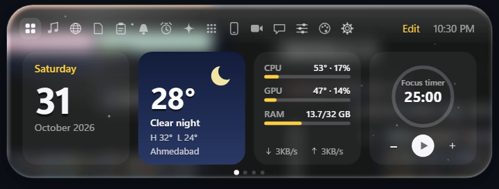
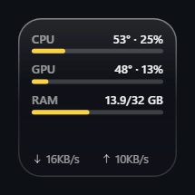
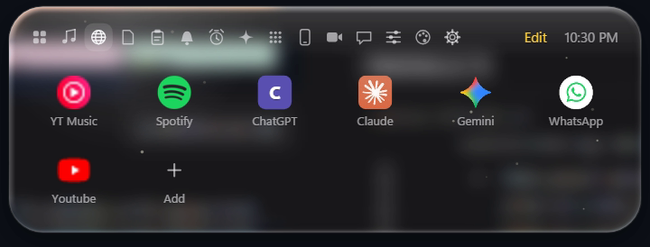
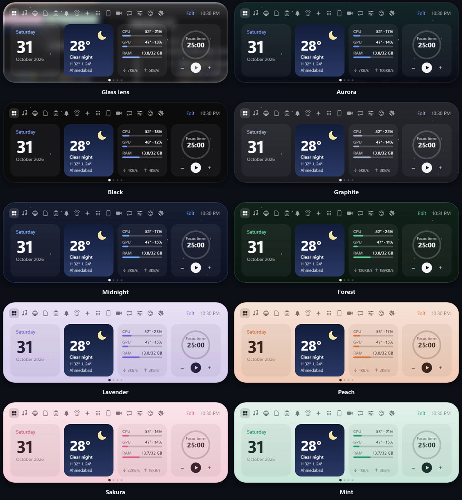
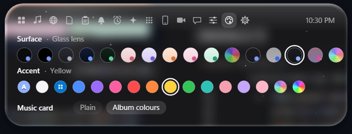
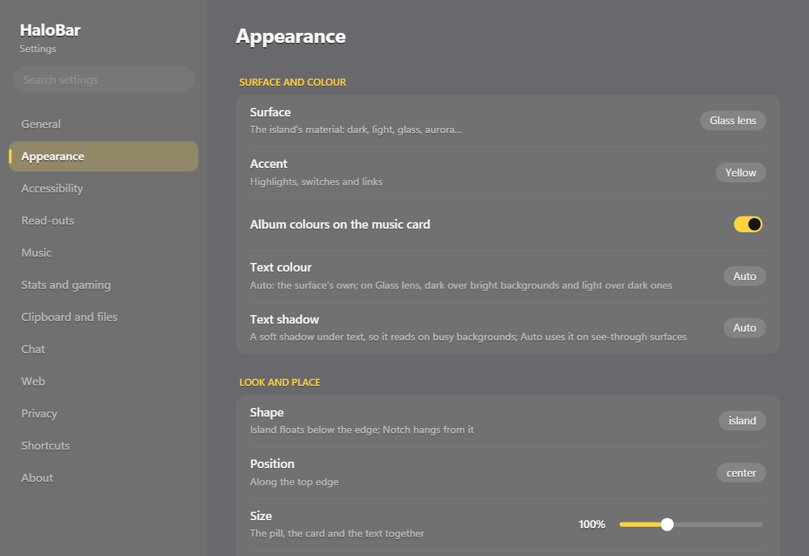

# HaloBar

**A Dynamic Island for Windows.** HaloBar sits at the top of every screen as a small pill that
shows what's happening — the song playing, a call, a timer, a download, a recording — and opens
into a card of panels when you rest the pointer on it. Volume, brightness and battery changes
appear in it instead of Windows' pop-ups, notifications arrive as compact banners, and a dozen
small tools live one hover away.



- **Version:** 0.6.0 · Windows 10 (2004) or later, Windows 11 · x64
- **Written in:** C# / .NET 10, Win32, SkiaSharp (drawn on the GPU with Direct3D 12), DirectComposition
- **Languages:** 21 (English, हिन्दी, ગુજરાતી, Español, Français, Deutsch, 日本語, 中文 and more)

---

## Contents

- [Install](#install)
- [The pill](#the-pill)
- [Panels](#panels)
- [Home tiles and desktop widgets](#home-tiles-and-desktop-widgets)
- [Web windows](#web-windows)
- [Screen tools](#screen-tools)
- [Controls, profiles and layouts](#controls-profiles-and-layouts)
- [PC health](#pc-health)
- [Look and feel](#look-and-feel)
- [Keyboard shortcuts](#keyboard-shortcuts)
- [Settings](#settings)
- [Privacy: what stays on your PC](#privacy-what-stays-on-your-pc)
- [Local API](#local-api)
- [Build from source](#build-from-source)
- [How it is put together](#how-it-is-put-together)
- [Known limits](#known-limits)
- [Roadmap](#roadmap)

---

## Install

1. Download `HaloBar-Setup-0.6.0.exe` and run it. It installs for your Windows user only (no
   administrator rights) and is self-contained: nothing else to install.
2. Windows may show **"Windows protected your PC"** because the installer isn't code-signed yet:
   choose **More info → Run anyway**.
3. HaloBar starts with Windows (switchable in Settings) and lives in the tray. Uninstall from
   Windows' *Installed apps* as usual.

Your settings are per Windows user, in `%AppData%\HaloBar`.

---

## The pill

At rest the island is a small pill at the top of each monitor (or a thin line over maximised
windows). It shows, most important first:

| What | Shows |
|---|---|
| **Recording** | HaloBar's screen recording, with elapsed time |
| **Call** | Teams, Zoom, Meet, WhatsApp, Discord and others while they use the mic: muted or live, call length |
| **Meeting** | The next calendar meeting from 10 minutes before, with a **Join** button when it has a Teams/Meet/Zoom link |
| **Focus timer** | Focus or break, with a progress ring |
| **AI agents** | What Claude Code, Codex or Gemini CLI is doing, and when it needs you |
| **Download** | File name, size and speed |
| **Music** | Album art, title and a visualizer |

**HUDs** replace Windows' own pop-ups: volume, brightness, battery (charging, unplugged, low),
Bluetooth devices connecting, Caps/Num/Scroll Lock, microphone mute. **Privacy dots** — green for
the camera, orange for the microphone — show while any app uses them, and the Call panel names it.

**Notifications** from Windows (and from scripts, through the local API) appear as compact
banners: icon, bold title, one line. Do not disturb holds them in the list instead.

While a game is full screen, an optional **game strip** shows CPU, GPU, RAM, network and the clock.

---

## Panels

Hover the pill (or press `Ctrl+Alt+I`) and it opens into a card with tabs:

| Panel | What it does |
|---|---|
| **Home** | Pages of tiles you choose in *Edit* (see below); each wide or narrow |
| **Music** | Artwork, title, progress (wave, simple, pixels, comet or hearts; click to seek), synced lyrics (LRCLIB), controls; the cover's colours drift behind. Choose which apps count as music |
| **Web** | Your sites (YouTube, YT Music, Spotify, ChatGPT, Claude, Gemini, WhatsApp…) in their own windows — see [Web windows](#web-windows) |
| **Files** | The shelf: drop files on the island to keep them at hand; screenshots and exports land here. Drag them out again, open, show in Explorer, copy |
| **Clipboard** | Recent copies (text, files, pictures) with a search box (`Ctrl+Alt+B`), filters and pinned snippets. Private copies from password managers are skipped |
| **Notifications** | Everything that arrived, newest first; click to open the app |
| **Reminders** | Reminders in plain words — "call mum at 6:30pm", "stretch in 45m", "tomorrow 9am pay rent" — with repeats, and a to-do list |
| **Agents** | Claude Code, Codex and Gemini CLI sessions: working, waiting for you, done (hooks report to this PC only) |
| **Apps** | Six app slots from the Start menu, and saved **window layouts** |
| **Phone** | A QR code: your phone opens a page on your Wi-Fi to download shelf files and send files back |
| **Call** | Camera mirror, mic mute, and which apps use the camera or microphone |
| **Chat** | A Twitch or YouTube live chat, with pop-ups on the pill and an optional on-screen overlay |
| **Controls** | Quick settings — see [Controls](#controls-profiles-and-layouts) |
| **Style** | Surfaces and accent colours |
| **Settings** | Every option, also in its own window |

---

## Home tiles and desktop widgets

28 tiles, shown on Home pages in the island or pinned to the desktop as [widgets](#desktop-widgets):

| Everyday | Information | Tools |
|---|---|---|
| Date, Month calendar | Weather (Open-Meteo), Air quality & sun | Calculator, Unit converter |
| World clock | CPU / GPU / RAM / network with temperatures | Currency converter |
| Focus timer (today's focus minutes) | This PC, Storage, Network | Translator, Dictionary |
| To-do, Note | Battery, **Battery health** (wear, cycles, capacity chart) | Stopwatch, Counter, Countdown |
| Next meeting (calendar link) | Screen time (today and this week) | Git repositories, Docker |
| Photos slideshow | Stocks & crypto ticker, with price alerts | |

**On Home:** open the island's Home tab and press **Edit**. With **Island** selected, click a tile to
add it, again to make it wide, again to remove it. Tiles fill pages of four; the dots under them
switch pages (and the mouse wheel scrolls through them).

### Desktop widgets



Any tile can also live on the desktop as a small glass card — a clock, the weather, the focus timer,
your to-do list, the calculator or translator ready to type into, CPU and memory, a photo frame.

- **Add one:** Home › **Edit** › **Desktop**, then click a tile to pin it to the desktop, again to make
  it wide, again to unpin it. A new widget takes a free spot in tidy columns, so it never lands on
  top of another one.
- **Move it:** drag it anywhere, on any monitor; the place is remembered. A widget left off-screen
  (after a monitor is unplugged, say) is brought back into view.
- **Right-click it** for **Make wide / Make narrow** and **Remove from desktop**.
- **Use it:** widgets are live, not pictures. Buttons work (start the timer, tick off a to-do), and
  text boxes take normal typing — selection, Ctrl+A/C/X/V/Z, word-by-word with Ctrl.
- **Where they sit:** just above the wallpaper and below your apps. They stay visible after
  **Win+D** (Show desktop), never cover the window you're working in, and come back as soon as the
  desktop is in front.
- **Look:** glass cards with Windows' live blur behind, tinted in the island's surface colour, with a
  sheen across the top and a soft rim. When the text colour is dark, the cards turn light so it stays
  readable.
- **Light on the PC:** a widget hidden behind windows isn't redrawn, and only a few redraw in any one
  frame.
- **Profiles** (Work, Gaming, Night) remember which widgets are on the desktop and where.

---

## Web windows

Sites open in their own windows (Microsoft Edge WebView2), not a browser tab:



- **One window per site**, each in Alt+Tab and the taskbar, remembering where you left it; or
  drop-down mode, where a site hangs under the island and hides when you click away.
- **Back, Forward, Reload, Home**, Open in browser, Close page; **maximise, minimise, Snap**, and
  real **full screen** for videos (or `F11` for the whole site).
- **Ad blocking** in every page: ad and tracker hosts are refused, ad data is removed from YouTube's
  player responses (YouTube and YouTube Music included), and any ad that still plays is muted, sped
  up and skipped. See [docs/ad-blocking-plan.md](docs/ad-blocking-plan.md).
- **Video glow**: the page around a playing video lights up in the picture's colours, like ambient
  light strips.
- **Focus mode** keeps chosen sites (social media by default) closed while the focus timer runs.
- Unpacked browser extensions can be added in Settings.

---

## Screen tools

| Tool | How |
|---|---|
| **Screenshot** | `Ctrl+Alt+F`: Windows' region snip; saved to `Pictures\HaloBar`, copied, put on the shelf; click the notice to mark it up |
| **Copy text from the screen** | `Ctrl+Alt+X`: select an area, its text is copied (Windows' own OCR, on your PC) |
| **Scan a QR code** | `Ctrl+Alt+Q`: select it; the content is copied, and links open with a click |
| **Screen recording** | `Ctrl+Alt+V` to start and stop: MP4 with the PC's sound and optionally your microphone, saved to `Videos\HaloBar` and copied |
| **Colour picker** | `Ctrl+Alt+C`: the colour under the pointer, copied as `#RRGGBB` |
| **OBS** | Start/stop recording through OBS's websocket, with the recording time on the pill |

---

## Controls, profiles and layouts

The **Controls** panel (`Ctrl+Alt+K`):

- **Wi-Fi** on/off, a list of nearby networks — connect (asks for the password when needed),
  disconnect, ping and a speed test.
- **Bluetooth** on/off, paired devices — connect and disconnect headphones and speakers, forget a
  device, or **Add device** to pair a new one (the code to compare shows on the island).
- Night light, sound and mic switches, volume and brightness sliders, default speaker and mic.
- **Profiles — Work, Gaming, Night**: the first tap saves how things are now (theme, glass, island
  place and size, Home tiles, desktop widgets, Do not disturb, speaker and mic, Night light);
  later taps switch everything back to it.

**Window layouts** (Apps panel): *Save layout* remembers where your windows are, maximised ones
included; clicking a layout puts them back and starts any app that isn't running.

---

## PC health

- **Alerts** when the CPU (90 °C) or GPU (87 °C) stays hot, memory stays above 92% (naming the app
  using the most), or the Windows drive is nearly full. Each repeats at most every 30 minutes.
- **Battery health** from Windows' battery report: what the battery holds now against what it was
  made to hold, charge cycles, and capacity over time.
- **Charge reminder** at 80% or 90% while plugged in.
- **Internet watch**: says when the connection drops and when it's back; ping and speed test in Controls.
- **Screen-time** totals per app and a break reminder.

---

## Look and feel





- **16 surfaces**: Black, Pure black, Graphite, Midnight, Forest, Rosé, Lavender, Peach, Sakura, Mint,
  Aurora (drifting), Acrylic, Frost, Candy glass, Album (follows the cover art) and **Glass lens** — a
  liquid-glass lens that bends and blurs what's behind the island, with highlights and a soft shadow.
- **Accents**: 16 colours, Windows' accent, the surface's own, or any `#RRGGBB`.
- Island or notch shape, size, corner roundness, position (left, centre, right), distance from the top,
  open size, glass blur, text colour and shadow, animation speed, reduced motion, larger text and higher
  contrast.
- Hidden until hover, slim over maximised windows, per-app rules (hide, slim or normal while an app is in front),
  hide in full screen.
- **Show in screenshots and sharing** (Ctrl+Alt+J): on, the island appears in screenshots, screen
  shares and other apps' recordings, and the Glass lens fills its own spot from the screen around it;
  off (the default), it's hidden from them and the lens sees exactly what's behind it.

---

## Keyboard shortcuts

All of them can be changed (or turned off) in Settings › Shortcuts.

| Keys | Does |
|---|---|
| `Ctrl+Alt+I` | Open or close the island |
| `Ctrl+Alt+P` | Play / pause |
| `Ctrl+Alt+T` | Start / pause the focus timer |
| `Ctrl+Alt+H` | Hide / show the island |
| `Ctrl+Alt+M` | Mute / unmute the microphone |
| `Ctrl+Alt+E` | New reminder |
| `Ctrl+Alt+O` | Next sound output |
| `Ctrl+Alt+C` | Pick a colour |
| `Ctrl+Alt+F` | Screenshot |
| `Ctrl+Alt+X` | Copy text from the screen |
| `Ctrl+Alt+Q` | Scan a QR code on the screen |
| `Ctrl+Alt+V` | Record the screen (again to stop) |
| `Ctrl+Alt+R` | OBS: start / stop recording |
| `Ctrl+Alt+W` | Show / hide the web windows |
| `Ctrl+Alt+K` | Open Controls |
| `Ctrl+Alt+B` | Search the clipboard history |
| *(unset)* | Next / previous track, next profile, Do not disturb, open app in slot 1–6 |

A shortcut another app already holds is skipped and noted in the log.

---

## Settings

Open the island's Settings tab, or **Open window** for a separate Settings window with a sidebar
and search: General, Appearance, Accessibility, Read-outs, Music, Stats and gaming, Clipboard and
files, Chat, Web, Privacy, Shortcuts, About. Sliders move in steps of 1 and save when let go.



---

## Privacy: what stays on your PC

Almost everything runs on your PC. HaloBar contacts these services only for the features that need them:

| Feature | Service |
|---|---|
| Weather, air quality | Open-Meteo |
| Synced lyrics | LRCLIB |
| Stocks and crypto | Yahoo Finance, CoinGecko |
| Translator, spelling | Google Translate's web endpoint, Datamuse |
| Currency rates | Frankfurter (European Central Bank rates) |
| Internet watch, speed test | a ping to 1.1.1.1 / 8.8.8.8; Cloudflare's speed test when you press it |
| Calendar | the ICS link you paste |

Text from the screen (OCR), QR codes, screen recordings, clipboard history and screenshots never leave
the PC. The local API listens on `127.0.0.1` only; *Send to phone* is the one feature that opens a port
on your network, and only while its QR code shows.

Data lives in `%AppData%\HaloBar`: `settings.json` (settings, reminders, to-dos, shelf, layouts,
profiles), `clipboard.json` (history) and `halobar.log`.

---

## Local API

Scripts and other apps can talk to HaloBar on `http://127.0.0.1:47900`:

```bash
# A notification on the pill
curl "http://127.0.0.1:47900/notify?title=Build%20passed&body=All%20tests%20green&app=CI"

# Change the look
curl "http://127.0.0.1:47900/style?surface=lens&accent=%23FF8800&album=on"

# Report an agent's state on the pill and in the Agents panel
curl "http://127.0.0.1:47900/agent?name=Build%20bot&state=working&text=Compiling&project=website"

# Open the island on a panel (Home pages: home:2)
curl "http://127.0.0.1:47900/panel?name=controls"

# Show a web window, open the Settings window on a page, start or stop a recording
curl "http://127.0.0.1:47900/web?site=YouTube"
curl "http://127.0.0.1:47900/settings?page=Appearance"
curl "http://127.0.0.1:47900/record?action=toggle"

# Save the island's next frame to %AppData%\HaloBar\snapshot.png
curl "http://127.0.0.1:47900/snapshot?panel=home"
```

---

## Build from source

Requires the **.NET 10 SDK** on Windows 10 2004 (build 19041) or later.

```bash
dotnet run --project src/HaloBar
```

```bash
dotnet test tests/HaloBar.Tests
```

The installer (self-contained, Inno Setup 6):

```bash
powershell -File installer/build.ps1
```

Translations: `tools/extract_strings.py` collects the English text, `tools/translate.py` fills
`src/HaloBar/Languages/<code>.json` (only new strings), and `tools/fix_island_terms.py` keeps
"island" and "pill" from being translated literally.

---

## How it is put together

```
src/HaloBar
├─ Program.cs        frame loop, HUDs and activities, hotkeys, tray, glass feeding
├─ Platform/         Win32: overlay, widget and web windows, tray, clipboard, drag and drop,
│                    shell thumbnails, monitors, full-screen check, volume pop-up, ad blocker
├─ Rendering/        GPU drawing (Skia on Direct3D 12), DirectComposition surfaces, glass
│                    (desktop duplication or screen copy), acrylic backdrop, palette, images
├─ Services/         media, audio, mic, brightness, power, Bluetooth, Wi-Fi, privacy, weather,
│                    stats, health, timer, reminders, calendar, lyrics, shelf, downloads,
│                    ticker, OBS, agents, launcher, profiles, layouts, recorder, OCR/QR, local API
└─ UI/               IslandView (states, shape, tabs), Ui (drawing and hits), panels, tiles,
                     desktop widgets, Settings window, theme, icons, languages
tests/HaloBar.Tests  parsers and logic: reminders, ICS, lyrics, chat, palette, agents, profiles,
                     focus blocking, OCR and QR, layouts, battery report
```

- Each island is a click-through `WS_EX_LAYERED | WS_EX_NOACTIVATE | WS_EX_NOREDIRECTIONBITMAP` popup.
  Its pixels come from a premultiplied-alpha swap chain on a DirectComposition visual, so the edges
  are soft and transparent. It only takes the keyboard while you type into one of its fields.
- **Drawing on the GPU:** Skia draws straight into each swap chain's buffer with Direct3D 12 — no CPU
  raster and no per-frame upload. If the GPU can't, it falls back to drawing on the CPU (also
  switchable in Settings). All monitors share one device; frames are paced with one `DwmFlush`, and
  the loop sleeps while nothing moves.
- **Glass lens:** the screen behind the island is read with Desktop Duplication where the GPU offers
  it (HDR screens included) or copied on a background thread, blurred, and drawn through an SkSL lens
  shader. It recovers by itself after the PC is locked.
- When idle, the app compacts its heap and trims its working set.

---

## Known limits

- **Unsigned installer:** Windows warns on first run until the installer is code-signed.
- **Notification mirroring** needs Windows' permission (Settings › Privacy › Notifications).
- **Volume pop-up:** Windows' own pop-up is hidden by giving it an empty region; HaloBar gives it back on
  exit. If HaloBar is killed, it stays hidden until Explorer restarts.
- **Send to phone** needs the network set to Private; Windows asks once to allow it through the firewall.
- **Bluetooth:** Windows only lets apps connect and disconnect audio devices (headphones, speakers).
- **Browser extensions** in the web windows don't load yet.

---

## Roadmap

- Clipboard actions: copied maths, units, currency, colours and links get a result or a button on the pill
- Synced lyrics on the pill, weather animations on the island
- Automatic focus during meetings or chosen apps; a weekly screen-time report
- Nearby Share from the island; calendar sign-in (Google, Outlook)
- Ad blocking phases 2–4 (bigger lists, rules that update, extensions); Arabic right-to-left layout;
  a built-in screenshot editor
- Later: a signed installer and updates from GitHub releases
