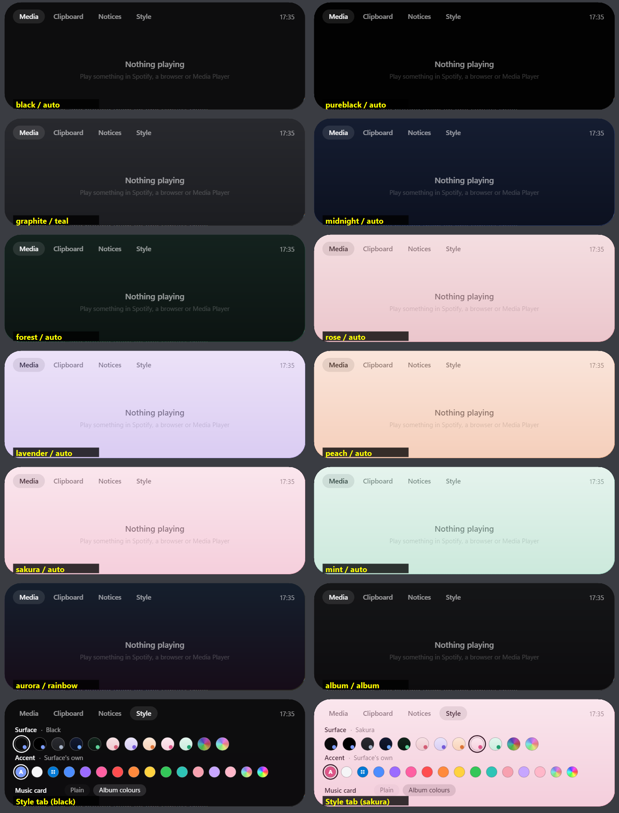

# HaloBar

A Dynamic Island–style bar for Windows. It sits at the top of the screen as a small pill,
shows what's going on (music, timers, calls, downloads, agents), and opens into a card of
panels when you rest the pointer on it.



See [FEATURES.md](FEATURES.md) for the full list and what has been checked.

## Panels (v0.4)

| Panel | What it does |
|---|---|
| **Home** | Up to four tiles: date, weather (Open-Meteo), CPU/GPU/RAM/network, Pomodoro timer, world clock, to-do, battery, next meeting, stock/crypto ticker, photo slideshow. *Edit* picks them. |
| **Music** | Artwork, title, progress (wave, simple, pixels, comet or hearts; click to seek), the line being sung (LRCLIB), controls, the cover's colours drifting behind. |
| **Files** | Drop files on the island to keep them at hand; screenshots land here. Open, show in Explorer, copy. |
| **Clipboard** | The last things you copied (text, files, pictures), filters, pinned snippets. Private copies (password managers) are skipped. |
| **Notifications** | Windows notifications and the local API's, newest first; click to open the app. |
| **Reminders** | Reminders typed in plain words ("call mum at 6:30pm", "stretch in 45m", "tomorrow 9am pay rent"), with repeats; a to-do list beside them. |
| **Agents** | What Claude Code (and anything using the local API) is doing: working, needs you, done. *Connect Claude Code* adds hooks that report to this PC only. |
| **Apps** | Six launcher slots, filled from every Start-menu app. |
| **Phone** | A QR code: the phone opens a page on your Wi-Fi to download shelf files and send files back. |
| **Call** | A camera mirror, mic mute, and which apps use the camera or microphone. |
| **Chat** | A Twitch channel's live chat, with pop-ups on the pill (off by default). |
| **Controls** | Wi-Fi, Bluetooth, Night light, sound and mic switches, volume and brightness, default speaker and mic. |
| **Style** | 15 surfaces (including see-through Acrylic, Frost and Candy glass, drifting Aurora and album-following Album) and 16 accents plus any `#RRGGBB`. |
| **Settings** | Every switch: HUDs, music, island shape/position/size/corners, hidden until hover, slim over maximised windows, game strip, OBS, agents, panels, per-app rules, start with Windows. |

On the pill: HUDs for volume (replacing Windows' pop-up), brightness, battery, Bluetooth devices,
Caps/Num/Scroll Lock, mic mute, camera/mic in use; live activities for calls, OBS recording,
agents, meetings, the focus timer and downloads; green and orange privacy dots; a stats strip
while a game is full screen.

## Hotkeys

| Keys | Does |
|---|---|
| `Ctrl+Alt+I` | Open or close the island |
| `Ctrl+Alt+P` | Play / pause |
| `Ctrl+Alt+T` | Start / pause the focus timer |
| `Ctrl+Alt+M` | Mute / unmute the microphone |
| `Ctrl+Alt+E` | New reminder |
| `Ctrl+Alt+F` | Screenshot (Windows' region snip; saved to Pictures\HaloBar and the shelf) |
| `Ctrl+Alt+C` | Copy the colour under the pointer |
| `Ctrl+Alt+R` | OBS: start / stop recording |
| `Ctrl+Alt+O` | Next speaker |
| `Ctrl+Alt+H` | Hide / show the island |

A shortcut another app already holds is skipped and noted in the log.

## Build, run, test

Requires the .NET 10 SDK on Windows 10 2004 (19041) or later.

```bash
dotnet run --project src/HaloBar
```

```bash
dotnet test tests/HaloBar.Tests
```

Data lives in `%AppData%\HaloBar`: `settings.json` (settings, reminders, to-dos, shelf),
`clipboard.json` (text and file history) and `halobar.log`.

## Local API

Listens on `127.0.0.1` only. (Send to phone is the one feature that opens a port on your
network, and only while its QR code is showing.)

```bash
curl "http://127.0.0.1:47900/notify?title=Build%20passed&body=All%20tests%20green&app=CI"
```

```bash
curl "http://127.0.0.1:47900/style?surface=sakura&accent=%23FF8800&album=on"
```

```bash
curl "http://127.0.0.1:47900/agent?name=Build%20bot&state=working&text=Compiling&project=website"
```

```bash
curl "http://127.0.0.1:47900/panel?name=reminders"
```

`/snapshot?panel=home` saves the island's next frame to `%AppData%\HaloBar\snapshot.png`.

## How it is put together

```
src/HaloBar
├─ Program.cs        frame loop, HUD/activity wiring, hotkeys, tray
├─ Platform/         Win32: overlay and host windows, tray, clipboard, drag and drop,
│                    shell thumbnails, monitors, foreground/full-screen check, volume pop-up
├─ Rendering/        D3D11 + DirectComposition surface, acrylic backdrop, album palette, images
├─ Services/         media, audio, mic, brightness, power, Bluetooth, privacy, weather, stats,
│                    timer, reminders, calendar, lyrics, shelf, downloads, ticker, OBS, agents,
│                    launcher, phone share, chat, camera, local API
└─ UI/               IslandView (states, shape, tabs), Ui (drawing + hits), panels, theme, icons
tests/HaloBar.Tests  parsers and logic: reminders, ICS, lyrics, chat, uploads, palette, agents
```

* The window is a `WS_EX_LAYERED | WS_EX_TRANSPARENT | WS_EX_NOACTIVATE |
  WS_EX_NOREDIRECTIONBITMAP` popup; its pixels come from a premultiplied-alpha swap chain on a
  DirectComposition visual. It only takes the keyboard while you type into one of its fields.
* Skia draws each frame on the CPU; all monitors share one D3D11 device, and animation is paced
  with a single `DwmFlush`. When nothing moves, the loop sleeps (about 0.5% CPU).
* When idle for 10 s the app compacts its heap and trims its working set.

## Known limits

* Windows notification mirroring depends on Windows granting access (Settings › Privacy › Notifications).
* The Windows volume pop-up is hidden by giving Explorer's pop-up window an empty region; HaloBar gives
  it back on exit. If HaloBar is killed, the pop-up stays hidden until Explorer restarts.
* Send to phone needs the network set to Private; Windows asks once to allow HaloBar through the firewall.
* Not yet: Glass lens surface, own screen recorder, FPS counter, web panel, YouTube chat, Codex/Gemini hooks,
  hotkey editor, desktop widgets, languages other than English.
